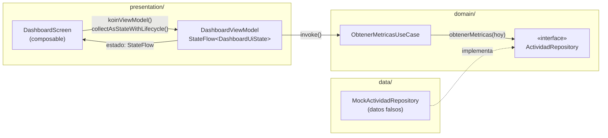
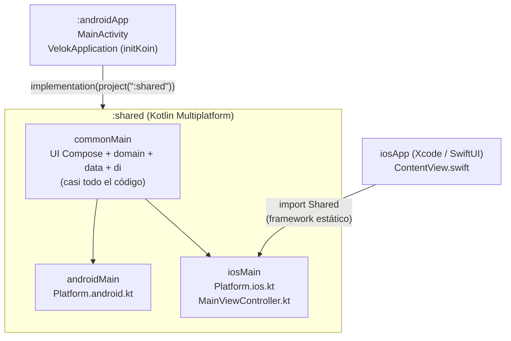

# Velok — Avance 01

Documento para el equipo: qué se hizo en el primer avance, cómo está organizado el código y cómo
seguir trabajando sobre él. Está escrito para quien conoce Kotlin pero no necesariamente
Kotlin Multiplatform (KMP).

> Todo lo descrito aquí existe en el repositorio a la fecha de este documento. Lo que falta está en
> la sección [Pendientes y siguientes pasos](#11-pendientes-y-siguientes-pasos).

## Contenido

1. [Resumen del proyecto](#1-resumen-del-proyecto)
2. [Qué se implementó en este avance](#2-qué-se-implementó-en-este-avance)
3. [Arquitectura](#3-arquitectura)
4. [Estructura de carpetas](#4-estructura-de-carpetas)
5. [Cómo se cumple cada criterio de evaluación](#5-cómo-se-cumple-cada-criterio-de-evaluación)
6. [Stack y librerías](#6-stack-y-librerías)
7. [Decisiones técnicas](#7-decisiones-técnicas)
8. [Cómo ejecutar el proyecto](#8-cómo-ejecutar-el-proyecto)
9. [Cómo agregar una nueva pantalla](#9-cómo-agregar-una-nueva-pantalla)
10. [Flujo de trabajo con Git](#10-flujo-de-trabajo-con-git)
11. [Pendientes y siguientes pasos](#11-pendientes-y-siguientes-pasos)

---

## 1. Resumen del proyecto

**Velok** es una app de gimnasio para el seguimiento de sesiones de entrenamiento. Muestra la
actividad física del día (calorías, pasos, distancia, ritmo cardiaco), planes de entrenamiento y
un catálogo de ejercicios por categoría.

**Objetivo:** construir una sola app que funcione en **Android e iOS** compartiendo la interfaz y
la lógica, con una arquitectura en capas que permita cambiar el origen de los datos (hoy simulados;
después Health Connect/HealthKit y la API de ExerciseDB) sin tocar las pantallas.

**Criterios de evaluación del proyecto escolar:**

| Criterio | Qué se evalúa |
|---|---|
| Vistas | Pantallas y componentes visuales fieles al diseño |
| Capas | Separación de responsabilidades (arquitectura) |
| Modelo de negocio | Entidades y reglas del dominio de la app |
| Multiplataforma | Código compartido entre Android e iOS |
| Funcionalidad | Que la app haga lo que promete |

En la [sección 5](#5-cómo-se-cumple-cada-criterio-de-evaluación) se explica cómo se cubre cada uno.

---

## 2. Qué se implementó en este avance

El diseño de referencia está en [`docs/diseno/mockup-dashboard-ejercicio.jpeg`](diseno/mockup-dashboard-ejercicio.jpeg).

### Pantallas

**Inicio (Dashboard)** — `presentation/dashboard/DashboardScreen.kt`
- Tarjeta **"Actividad diaria"** con la fecha de hoy en español (ej. "14 Octubre 2026") y un
  **anillo de progreso** (dona negra y verde lima) dibujado con `Canvas` y animado.
- Cuadrícula **2x2 de métricas**: Calorías (160 kcal), Pasos (2,032), Distancia (1.5 km) y
  Ritmo cardiaco (90 lpm). Cada tarjeta tiene ícono, valor y una **mini gráfica de área**
  dibujada con `Canvas`. La columna izquierda es blanca con borde y la derecha crema, como en el mockup.
- Sección **"Planes"** con enlace "Ver todos" y un **carrusel horizontal** (`LazyRow`) de tarjetas
  con imagen, ícono, nombre y número de ejercicios (Pecho, Espalda, Pierna, Brazos).
- Estados de **carga** (indicador circular) y **error** (mensaje + botón "Reintentar").

**Ejercicio** — `presentation/ejercicio/EjercicioScreen.kt`
- Pestañas **"Ejercicio"** y **"Entrenamiento"** con indicador verde lima en la activa.
- En "Ejercicio": **cuadrícula escalonada** de 2 columnas (`LazyVerticalStaggeredGrid`) con 8
  categorías: Pecho, Fuerza, Pierna, Espalda, Brazos, Abdomen, Hombros y Cardio. Cada tarjeta
  tiene imagen de fondo, degradado verde lima abajo, ícono arriba a la izquierda y nombre abajo.
- "Entrenamiento" muestra una pantalla provisional ("Próximamente").

**Placeholders** — `components/Estados.kt` (`PlaceholderScreen`)
- **Calendario** y **Actividad**: título + "Próximamente".
- **Perfil**: título + "Próximamente" + **"Ejecutando en Android 35"** (o la versión de iOS). Este
  texto viene del ejemplo `expect/actual` de `Platform` (ver [sección 5](#multiplataforma)).

### Navegación inferior

`components/VelokBottomBar.kt` + `navigation/`
- 5 destinos: Inicio, Calendario, Ejercicio (mancuerna), Actividad y Perfil.
- El seleccionado se resalta con fondo verde lima suave.
- Cada pestaña **conserva su estado** al cambiar de una a otra (`saveState`/`restoreState`).
- "Ver todos" y las tarjetas de plan llevan a la pestaña Ejercicio.

### Encabezado

`components/VelokHeader.kt`
- Fondo negro con esquinas inferiores redondeadas que se extiende detrás de la barra de estado.
- **Logo de Velok** en verde lima, convertido del SVG original (`docs/diseno/logo_velok.svg`);
  es grande, empieza arriba a la izquierda y se corta en el borde inferior, como en el mockup.
- Campana de notificaciones con punto rojo.

### Tema visual

`presentation/theme/` — `VelokTheme`
- Color de acento **verde lima `#D3FA6E`**, encabezado negro, fondo crema, tarjetas blancas con
  bordes sutiles y esquinas redondeadas.
- Colores, tipografía y formas definidos en un solo lugar. Las pantallas **no** usan colores fijos.
- Todos los textos están en español en `composeResources/values/strings.xml`.

### Datos simulados

`data/repository/MockActividadRepository.kt` y `MockEjercicioRepository.kt`
- Devuelven datos fijos con un retraso de 300 ms para simular una carga real.
- Las imágenes son **placeholders** generados (fondos oscuros con degradado) en
  `composeResources/drawable/categoria_*.jpg`.

---

## 3. Arquitectura

Se usa **Clean Architecture + MVVM**. La idea central: cada capa solo conoce a la capa de abajo a
través de **interfaces**, así que se puede cambiar una pieza sin romper las demás.

| Capa | Paquete | Qué contiene | Qué **no** puede hacer |
|---|---|---|---|
| **Dominio** | `domain/` | Modelos (`Metrica`, `Plan`...), interfaces de repositorio y casos de uso | Usar Compose, recursos o textos visibles. Es Kotlin puro. |
| **Datos** | `data/` | Implementaciones de los repositorios (hoy, mocks) | Conocer pantallas o ViewModels |
| **Presentación** | `presentation/` | Pantallas, componentes, ViewModels, tema, navegación | Acceder directamente a repositorios |
| **DI** | `di/` | Koin: une las capas (qué implementación usar para cada interfaz) | — |

**MVVM** dentro de la capa de presentación:
- **View** (`XxxScreen` / `XxxContenido`): composables que dibujan el estado y avisan de eventos.
- **ViewModel** (`XxxViewModel`): pide datos a los casos de uso y expone un `StateFlow<XxxUiState>`.
- **Model / estado** (`XxxUiState`): `data class` inmutable con todo lo que la pantalla necesita
  (`cargando`, `error`, listas de datos...).

### Flujo de datos

Ejemplo real: cómo llegan las métricas a la pantalla de Inicio.



Paso a paso:
1. `DashboardScreen` obtiene su ViewModel con `koinViewModel()` y observa `estado`.
2. Al crearse, `DashboardViewModel` llama en paralelo (`async`) a tres casos de uso:
   `ObtenerActividadDiariaUseCase`, `ObtenerMetricasUseCase` y `ObtenerPlanesUseCase`.
3. Cada caso de uso calcula la fecha de hoy (con `kotlin.time.Clock`) y llama a la **interfaz**
   `ActividadRepository` o `EjercicioRepository`.
4. Koin (`di/Modulos.kt`) decidió que esas interfaces las implementan `MockActividadRepository` y
   `MockEjercicioRepository`.
5. El ViewModel actualiza el `StateFlow`; la pantalla se recompone sola con los nuevos datos.

Para cambiar a datos reales solo hay que crear, por ejemplo, `HealthConnectActividadRepository`
y cambiar **una línea** en `dataModule`. Pantallas, ViewModels y casos de uso no se tocan.

### Módulos del proyecto (KMP)



- **`shared`**: casi todo el código vive aquí. `commonMain` se compila para ambas plataformas;
  `androidMain` e `iosMain` contienen solo lo específico de cada una.
- **`androidApp`**: app Android mínima. `VelokApplication` inicia Koin y `MainActivity` llama a `App()`.
- **`iosApp`**: proyecto de Xcode. `ContentView.swift` muestra `MainViewController()`, que viene
  de `shared/iosMain` e inicia Koin antes de mostrar `App()`.

---

## 4. Estructura de carpetas

Solo se listan los archivos relevantes (se omiten íconos de lanzador, wrapper de Gradle, etc.).

```
Velok/
├── androidApp/                 App Android (punto de entrada)
├── iosApp/                     App iOS (proyecto Xcode)
├── shared/                     Código compartido KMP
│   └── src/
│       ├── commonMain/         Código común a Android e iOS
│       │   ├── composeResources/
│       │   │   ├── drawable/   Íconos (ic_*.xml), logo y placeholders (categoria_*.jpg)
│       │   │   └── values/     strings.xml (todos los textos en español)
│       │   └── kotlin/com/velok/app/
│       │       ├── domain/     model/, repository/, usecase/
│       │       ├── data/       repository/
│       │       ├── di/
│       │       └── presentation/  theme/, navigation/, components/, util/, dashboard/, ejercicio/
│       ├── commonTest/         Pruebas unitarias comunes
│       ├── androidMain/        Código solo Android
│       └── iosMain/            Código solo iOS
├── docs/
│   ├── diseno/                 Mockup y logo originales
│   └── AVANCE-01.md            Este documento
├── gradle/libs.versions.toml   Versiones de todas las librerías
├── CLAUDE.md                   Reglas del proyecto (también las sigue Claude Code)
└── README.md
```

Todas las rutas de abajo son relativas a `shared/src/commonMain/kotlin/com/velok/app/` salvo que
se indique otra cosa.

### Raíz de `com.velok.app`

| Archivo | Qué hace |
|---|---|
| `App.kt` | Composable raíz: aplica `VelokTheme`, crea el `NavController` y arma el `Scaffold` con encabezado, barra inferior y `VelokNavHost`. El fondo cambia a blanco en Ejercicio y crema en el resto. |
| `Platform.kt` | Declara `interface Platform` y `expect fun getPlatform()`. Ejemplo de código multiplataforma. |

### Capa `domain/`

| Archivo | Qué hace |
|---|---|
| `model/ActividadDiaria.kt` | Fecha (`LocalDate`) y progreso de la meta diaria (0.0 a 1.0). |
| `model/Metrica.kt` | `enum TipoMetrica` (CALORIAS, PASOS, DISTANCIA, RITMO_CARDIACO) y `Metrica` con valor e historial para la gráfica. |
| `model/CategoriaEjercicio.kt` | `enum TipoCategoria` (8 categorías) y `CategoriaEjercicio` con id, tipo e `imagenUrl`. |
| `model/Plan.kt` | Plan de entrenamiento: id, categoría, `imagenUrl` y número de ejercicios. |
| `repository/ActividadRepository.kt` | Interfaz: `obtenerActividadDiaria(fecha)` y `obtenerMetricas(fecha)`. |
| `repository/EjercicioRepository.kt` | Interfaz: `obtenerPlanes()` y `obtenerCategorias()`. |
| `usecase/ObtenerActividadDiariaUseCase.kt` | Obtiene la actividad de **hoy** (calcula la fecha con `Clock`). |
| `usecase/ObtenerMetricasUseCase.kt` | Obtiene las métricas de **hoy**. |
| `usecase/ObtenerPlanesUseCase.kt` | Obtiene la lista de planes. |
| `usecase/ObtenerCategoriasUseCase.kt` | Obtiene la lista de categorías de ejercicio. |

### Capa `data/`

| Archivo | Qué hace |
|---|---|
| `repository/MockActividadRepository.kt` | Implementa `ActividadRepository` con datos fijos (progreso 70%, 160 kcal, 2,032 pasos...). |
| `repository/MockEjercicioRepository.kt` | Implementa `EjercicioRepository`. Genera una categoría por cada `TipoCategoria` y 4 planes. Las imágenes son URIs de composeResources (`Res.getUri`). |

### Capa `di/`

| Archivo | Qué hace |
|---|---|
| `Modulos.kt` | Tres módulos de Koin: `dataModule` (repositorios como `single`), `domainModule` (casos de uso como `factory`) y `presentationModule` (ViewModels con `viewModelOf`). |
| `Koin.kt` | `initKoin()`: inicia Koin una sola vez; cada plataforma puede añadir configuración. |

### Capa `presentation/`

| Archivo | Qué hace |
|---|---|
| `theme/Color.kt` | Paleta base (`internal`) y `VelokColores`: colores **semánticos** (`acento`, `acentoTexto`, `fondo`, `superficie`, `borde`...). |
| `theme/Tipografia.kt` | Estilos de texto de Material 3 ajustados al diseño. |
| `theme/Formas.kt` | Radios de esquina y formas propias (encabezado, barra inferior). |
| `theme/VelokTheme.kt` | Composable `VelokTheme` y objeto `VelokTheme.colores / .tipografia / .formas / .formasVelok`. |
| `navigation/Rutas.kt` | Rutas tipadas (`RutaInicio`, `RutaEjercicio`...) y `enum DestinoPrincipal` con etiqueta e ícono de cada pestaña. |
| `navigation/VelokNavHost.kt` | Grafo de navegación, `navegarA()` (conserva estado entre pestañas) y `destinoPrincipal()` (qué pestaña está activa). |
| `components/VelokHeader.kt` | Encabezado negro con logo y campana. |
| `components/VelokBottomBar.kt` | Barra de navegación inferior. |
| `components/AnilloProgreso.kt` | Dona de progreso animada (Canvas). |
| `components/MiniGraficaArea.kt` | Mini gráfica de área (Canvas). |
| `components/MetricaCard.kt` | Tarjeta de una métrica (variante blanca o crema). |
| `components/PlanCard.kt` | Tarjeta del carrusel de planes (imagen con Coil). |
| `components/CategoriaCard.kt` | Tarjeta de categoría con imagen y degradado lima. |
| `components/Estados.kt` | `EstadoCargando`, `EstadoError` y `PlaceholderScreen`. |
| `util/Formato.kt` | `formatearMiles` (2032 → "2,032") y `formatearDecimal` (1.5 → "1.5"). Sin dependencias de plataforma. |
| `util/RecursosUi.kt` | Traduce enums del dominio a recursos de UI: nombre e ícono de cada categoría/métrica, valor con unidad y fecha en español. |
| `dashboard/DashboardUiState.kt` | Estado de Inicio: `cargando`, `error`, `actividad`, `metricas`, `planes`. |
| `dashboard/DashboardViewModel.kt` | Carga los tres casos de uso en paralelo; `cargar()` sirve también para reintentar. |
| `dashboard/DashboardScreen.kt` | `DashboardScreen` (con ViewModel) y `DashboardContenido` (sin estado, previsualizable). |
| `ejercicio/EjercicioUiState.kt` | `enum PestanaEjercicio` y estado de la pantalla. |
| `ejercicio/EjercicioViewModel.kt` | Carga categorías y guarda la pestaña seleccionada. |
| `ejercicio/EjercicioScreen.kt` | Pestañas y cuadrícula escalonada de categorías. |

### Recursos y pruebas

| Archivo | Qué hace |
|---|---|
| `composeResources/values/strings.xml` | Todos los textos visibles, incluido el arreglo `meses`. |
| `composeResources/drawable/ic_*.xml` | 16 íconos vectoriales propios. |
| `composeResources/drawable/logo_velok.xml` | Logo convertido del SVG del diseño. |
| `composeResources/drawable/categoria_*.jpg` | 8 imágenes placeholder. |
| `shared/src/commonTest/.../util/FormatoTest.kt` | Pruebas de `formatearMiles` y `formatearDecimal`. |

### Código por plataforma

| Archivo | Plataforma | Qué hace |
|---|---|---|
| `shared/src/androidMain/.../Platform.android.kt` | Android | `actual fun getPlatform()` → `"Android " + SDK_INT`. |
| `shared/src/iosMain/.../Platform.ios.kt` | iOS | `actual fun getPlatform()` → nombre y versión de `UIDevice`. |
| `shared/src/iosMain/.../MainViewController.kt` | iOS | Inicia Koin y crea el `UIViewController` con `App()`. |
| `androidApp/.../VelokApplication.kt` | Android | Inicia Koin con `androidContext`. |
| `androidApp/.../MainActivity.kt` | Android | Configura edge-to-edge (íconos claros arriba, oscuros abajo) y llama a `App()`. |
| `androidApp/src/main/AndroidManifest.xml` | Android | Registra `VelokApplication` y `MainActivity`. |
| `iosApp/iosApp/ContentView.swift` | iOS | Envuelve `MainViewController()` en SwiftUI. |
| `iosApp/Configuration/Config.xcconfig` | iOS | Nombre de la app y bundle id `com.velok.app.Velok`. |

---

## 5. Cómo se cumple cada criterio de evaluación

### Vistas
- Las dos pantallas del mockup (Inicio y Ejercicio) están implementadas y se compararon con el
  diseño en un emulador Android.
- Elementos gráficos dibujados con `Canvas`: anillo de progreso y mini gráficas.
- Componentes reutilizables con `@Preview` (`MetricaCard`, `PlanCard`, `CategoriaCard`,
  `VelokHeader`, `VelokBottomBar`, `AnilloProgreso`, `MiniGraficaArea`, `PlaceholderScreen`) y
  previews de cada pantalla completa (`DashboardContenidoPreview`, `EjercicioContenidoPreview`).
- Tema propio (`VelokTheme`): cambiar un color en `Color.kt` lo cambia en toda la app.
- Accesibilidad básica: descripciones para lectores de pantalla en la campana, el anillo, las
  métricas y la barra inferior; títulos marcados como encabezados.

### Capas
- Tres capas en paquetes separados (`domain`, `data`, `presentation`) más `di`. Ver [sección 3](#3-arquitectura).
- Las pantallas nunca usan un repositorio: siempre Pantalla → ViewModel → Caso de uso → Repositorio.
- La capa de dominio no importa nada de Compose ni de recursos.
- Inyección de dependencias con Koin: las clases reciben sus dependencias por constructor.

### Modelo de negocio
- Entidades del dominio: `ActividadDiaria`, `Metrica` (+ `TipoMetrica`), `Plan`,
  `CategoriaEjercicio` (+ `TipoCategoria`).
- Contratos (`ActividadRepository`, `EjercicioRepository`) que describen **qué** datos necesita la
  app sin decir **de dónde** vienen.
- Reglas en los casos de uso: por ejemplo, la actividad y las métricas siempre son "de hoy", y esa
  fecha la calcula el caso de uso (no la pantalla ni el repositorio).

### Multiplataforma
- Una sola base de código para Android e iOS: UI, lógica, recursos y textos están en `commonMain`.
- Librerías multiplataforma: Compose Multiplatform, Navigation, ViewModel, Koin, Coil 3, kotlinx-datetime.
- **Ejemplo `expect/actual` con `Platform`:**

  ```kotlin
  // commonMain/Platform.kt — se declara qué se necesita
  interface Platform { val name: String }
  expect fun getPlatform(): Platform

  // androidMain/Platform.android.kt — implementación Android
  class AndroidPlatform : Platform {
      override val name: String = "Android ${Build.VERSION.SDK_INT}"
  }
  actual fun getPlatform(): Platform = AndroidPlatform()

  // iosMain/Platform.ios.kt — implementación iOS
  class IOSPlatform: Platform {
      override val name: String = UIDevice.currentDevice.systemName() + " " + UIDevice.currentDevice.systemVersion
  }
  actual fun getPlatform(): Platform = IOSPlatform()
  ```

  El código común llama a `getPlatform()` sin saber en qué plataforma corre; el compilador usa
  el `actual` correspondiente. Se ve en la pantalla **Perfil** ("Ejecutando en Android 35"), desde
  `navigation/VelokNavHost.kt`.
- Otro ejemplo del mismo patrón: Koin se inicia en `VelokApplication` (Android) y en
  `MainViewController` (iOS), ambos llamando a la misma `initKoin()` común.

### Funcionalidad
- Navegación entre 5 pestañas que conserva el estado de cada una.
- Carga asíncrona con estados de carga, error y reintento.
- Cambio de pestañas en la pantalla Ejercicio.
- Fecha actual en español y números formateados (`2,032`, `1.5`), con pruebas unitarias.
- Imágenes cargadas con Coil, preparadas para venir de internet sin cambiar la UI.

---

## 6. Stack y librerías

Versiones tomadas de [`gradle/libs.versions.toml`](../gradle/libs.versions.toml).

| Librería / herramienta | Versión | Para qué se usa |
|---|---|---|
| Kotlin (Multiplatform) | 2.4.20 | Lenguaje y compilación para Android e iOS |
| Android Gradle Plugin | 9.3.3 | Compilar los módulos Android |
| Compose Multiplatform (`runtime`, `foundation`, `ui`, `components-resources`, `ui-tooling-preview`) | 1.12.1 | UI declarativa compartida, recursos (`Res`) y `@Preview` |
| Compose Material 3 | 1.12.0-alpha03 | Componentes Material (`Scaffold`, `Surface`, `Icon`, `Button`...) |
| Lifecycle (`lifecycle-viewmodel-compose`, `lifecycle-runtime-compose`) | 2.11.0 | `ViewModel` multiplataforma y `collectAsStateWithLifecycle` |
| Navigation Compose | 2.9.2 | Navegación con rutas tipadas |
| Koin (`koin-core`, `koin-compose`, `koin-compose-viewmodel`, `koin-android`) | 4.2.2 | Inyección de dependencias |
| Coil 3 (`coil-compose`) | 3.6.3 | Carga de imágenes (`AsyncImage`) |
| kotlinx-datetime | 0.8.0 | `LocalDate` y fecha de hoy en la zona horaria del dispositivo |
| kotlinx-serialization (`core` + plugin) | 1.11.0 | Requerido por las rutas tipadas de Navigation (`@Serializable`) |
| AndroidX Activity Compose | 1.13.0 | `setContent` y `enableEdgeToEdge` en `MainActivity` |
| kotlin-test | 2.4.20 | Pruebas unitarias en `commonTest` |

SDK Android: `minSdk` 24, `compileSdk` y `targetSdk` 37. Targets iOS: `iosArm64` (dispositivo)
e `iosSimulatorArm64` (simulador en Mac con Apple Silicon).

---

## 7. Decisiones técnicas

| Decisión | Por qué |
|---|---|
| **Íconos propios (XML) en vez de `material-icons-extended`** | Esa librería está congelada y ya no se recomienda en Compose Multiplatform; además pesa mucho. Los 16 íconos son vectores de trazo 24x24 en `composeResources/drawable`, y se colorean con `tint`. |
| **Material 3 en `1.12.0-alpha03`** | No existe una versión estable compilada para Compose Multiplatform 1.12. La última estable (1.9.0) está hecha para Compose 1.9. Se mantiene la alpha que trae la plantilla oficial hasta que salga la estable. |
| **Color `acentoTexto` (`#9DC53A`)** | El verde lima exacto `#D3FA6E` casi no se lee como texto sobre fondo blanco o crema. Se usa una variante más oscura **solo** para textos e íconos sobre fondo claro ("Actividad diaria", "Ver todos", pestaña activa). Anillos, gráficas, indicadores y degradados usan `#D3FA6E`. |
| **Logo convertido desde SVG** | El logo no se redibuja a mano: `logo_velok.xml` copia sin modificar los trazos de `docs/diseno/logo_velok.svg`. Su tamaño y posición son proporcionales al ancho de la pantalla, medidos sobre el mockup. Regla del proyecto: los recursos gráficos del diseño se toman de `docs/diseno`. |
| **Datos mock detrás de interfaces** | Permite construir y probar la UI sin depender de Health Connect, HealthKit ni de una API. Como la UI solo conoce las interfaces, cambiar a datos reales es cambiar el binding en `di/Modulos.kt`. |
| **Imágenes como URL (`imagenUrl: String`) + Coil** | Los mocks devuelven URIs locales (`Res.getUri(...)`); ExerciseDB devolverá URLs `https://`. `AsyncImage` carga ambas igual, así que la UI no cambia. |
| **Enums en el dominio, textos en presentación** | El dominio dice `TipoCategoria.PECHO`; la presentación lo traduce a "Pecho" y a su ícono (`util/RecursosUi.kt`). Así el dominio no depende de recursos ni de un idioma. |
| **Dos composables por pantalla (`XxxScreen` + `XxxContenido`)** | `XxxContenido` recibe el estado como parámetro: se puede previsualizar y probar sin Koin ni ViewModel. |
| **Fecha calculada en el caso de uso con `Clock` inyectable** | La regla "las métricas son de hoy" es de negocio. Recibir el `Clock` por constructor permite probar el caso de uso con una fecha fija. |
| **Proporciones del encabezado relativas al ancho** | El logo y la altura del encabezado se calculan con `BoxWithConstraints`, así se ven igual en pantallas de distinto tamaño. |
| **`.gitattributes` con finales de línea LF** | El equipo trabaja en Windows y Mac; evita diffs falsos por CRLF/LF. |

---

## 8. Cómo ejecutar el proyecto

### Requisitos
- **Android Studio** con el plugin de Kotlin Multiplatform.
- **JDK 21** (Gradle lo descarga automáticamente si no está instalado; ver `gradle/gradle-daemon-jvm.properties`).
- Para iOS: una **Mac con Xcode**. Desde Windows no se puede compilar la parte de iOS.

### Android
- **Android Studio:** abrir la carpeta del proyecto, esperar la sincronización de Gradle, elegir la
  configuración `androidApp` y presionar Run sobre un emulador o teléfono.
- **Terminal** (en Windows usar `gradlew.bat` o `./gradlew` desde Git Bash):
  ```bash
  ./gradlew :androidApp:assembleDebug   # genera androidApp/build/outputs/apk/debug/androidApp-debug.apk
  ./gradlew :androidApp:installDebug    # lo instala en el dispositivo/emulador conectado
  ```
- **Pruebas:**
  ```bash
  ./gradlew :shared:testAndroidHostTest
  ```

> **Nota sobre emuladores lentos:** en un emulador con poca RAM puede aparecer el aviso
> "isn't responding" al abrir la app o el propio System UI. En las pruebas de este avance se
> debió a la sobrecarga del emulador (CPU al 96–98%), no a la app. Si pasa, elige "Wait" o
> dale más RAM al emulador.

### iOS (requiere Mac)
1. Abrir `iosApp/iosApp.xcodeproj` en Xcode.
2. Elegir un simulador o un iPhone y presionar Run. Xcode compila el framework `Shared` con Gradle
   automáticamente.
3. Para correr en un iPhone físico, poner tu `TEAM_ID` en `iosApp/Configuration/Config.xcconfig`.

> La parte de iOS **todavía no se ha compilado** (el desarrollo se hizo en Windows). Ver pendientes.

---

## 9. Cómo agregar una nueva pantalla

Ejemplo: una pantalla **Historial** que muestre las sesiones de entrenamiento pasadas. Los nombres
son ilustrativos; adapta los modelos a lo que necesites.

### Paso 1 — Dominio (`domain/`)
1. **Modelo** en `domain/model/SesionEntrenamiento.kt`: una `data class` con los datos del negocio.
   Sin textos visibles ni recursos; si hay categorías, usa un `enum`.
2. **Interfaz de repositorio** en `domain/repository/SesionRepository.kt`, con funciones `suspend`:
   ```kotlin
   interface SesionRepository {
       suspend fun obtenerSesiones(): List<SesionEntrenamiento>
   }
   ```
   (Si los datos encajan en un repositorio existente, agrega la función ahí en lugar de crear otro).
3. **Caso de uso** en `domain/usecase/ObtenerSesionesUseCase.kt`:
   ```kotlin
   class ObtenerSesionesUseCase(private val repository: SesionRepository) {
       suspend operator fun invoke(): List<SesionEntrenamiento> = repository.obtenerSesiones()
   }
   ```

### Paso 2 — Datos (`data/`)
4. **Implementación mock** en `data/repository/MockSesionRepository.kt` que implemente la interfaz
   con datos falsos (puedes copiar el patrón de `MockActividadRepository`, incluido el `delay`).

### Paso 3 — Presentación (`presentation/historial/`)
5. **Estado** en `HistorialUiState.kt`:
   ```kotlin
   data class HistorialUiState(
       val cargando: Boolean = true,
       val error: Boolean = false,
       val sesiones: List<SesionEntrenamiento> = emptyList(),
   )
   ```
6. **ViewModel** en `HistorialViewModel.kt`: recibe el caso de uso por constructor, expone
   `estado: StateFlow<HistorialUiState>` y tiene `fun cargar()`. Copia la estructura de
   `EjercicioViewModel` (incluido volver a lanzar `CancellationException`).
7. **Pantalla** en `HistorialScreen.kt` con dos composables:
   - `HistorialScreen(viewModel: HistorialViewModel = koinViewModel())`: observa el estado.
   - `HistorialContenido(estado, onReintentar)`: dibuja; reutiliza `EstadoCargando` y `EstadoError`.
   - Un `@Preview` de `HistorialContenido` con datos de ejemplo.
8. **Textos** en `composeResources/values/strings.xml` (nunca literales en el código).
   **Colores y estilos** solo con `VelokTheme.colores`, `VelokTheme.tipografia` y `VelokTheme.formas`.
9. Si necesitas un componente nuevo y reutilizable, ponlo en `presentation/components/` con su `@Preview`.

### Paso 4 — Inyección de dependencias (`di/Modulos.kt`)
10. Registra las tres piezas:
    ```kotlin
    // dataModule
    single<SesionRepository> { MockSesionRepository() }
    // domainModule
    factory { ObtenerSesionesUseCase(get()) }
    // presentationModule
    viewModelOf(::HistorialViewModel)
    ```

### Paso 5 — Navegación (`presentation/navigation/`)
11. En `Rutas.kt`, agrega la ruta: `@Serializable data object RutaHistorial`.
12. En `VelokNavHost.kt`, agrega el destino: `composable<RutaHistorial> { HistorialScreen() }`.
13. Si la pantalla reemplaza a un placeholder de la barra inferior (por ejemplo Actividad), basta
    con cambiar el contenido de su `composable<RutaActividad>`. Si es una pantalla nueva fuera de la
    barra, navega con `navController.navigate(RutaHistorial)`.

### Paso 6 — Verificar
14. `./gradlew :androidApp:assembleDebug` y `./gradlew :shared:testAndroidHostTest`.
15. Revisa los `@Preview` en Android Studio y prueba en el emulador.

---

## 10. Flujo de trabajo con Git

1. **Actualiza `main` antes de empezar:**
   ```bash
   git checkout main
   git pull
   ```
2. **Crea una rama** para tu tarea a partir de `main` actualizado:
   ```bash
   git checkout -b feature/nombre-corto   # ej. feature/pantalla-historial
   ```
   Nunca se trabaja directamente sobre `main`.
3. **Haz tus commits manualmente**, pequeños y con mensajes en español que digan qué cambió:
   ```bash
   git status
   git add <archivos>
   git commit -m "Agregar pantalla de historial de sesiones"
   ```
   Cada integrante hace sus propios commits. Claude Code **no** ejecuta comandos de git que
   modifiquen el repositorio: solo consulta (`status`, `diff`, `log`) y al final sugiere un mensaje
   de commit (regla en `CLAUDE.md`).
4. **Sube tu rama:**
   ```bash
   git push -u origin feature/nombre-corto
   ```
5. **Abre un Pull Request** en GitHub hacia `main`. Antes de pedir revisión, verifica que compile y
   pasen las pruebas.
6. **Fusiona con "Squash and merge"**: todos los commits de la rama quedan como **un solo commit**
   en `main`, con un historial limpio (un commit por funcionalidad).
7. Después de fusionar, borra la rama y vuelve al paso 1 para la siguiente tarea.

> Para documentación se puede usar el prefijo `docs/` (como la rama `docs/avance-01` de este
> documento). El PR #1 (`feature/primer-avance`) se fusionó con un *merge commit*; a partir de ahora
> se usa *Squash and merge*.

---

## 11. Pendientes y siguientes pasos

### Planeados
- [ ] **Imágenes reales:** reemplazar los placeholders `composeResources/drawable/categoria_*.jpg`
      por fotos reales (mismo nombre de archivo, o URLs de ExerciseDB).
- [ ] **Health Connect (Android) / HealthKit (iOS):** crear repositorios reales que implementen
      `ActividadRepository`. Como son APIs de cada plataforma, la implementación irá en
      `androidMain`/`iosMain` (con `expect/actual` o una interfaz común) y requiere pedir permisos.
- [ ] **API de ExerciseDB:** crear un repositorio que implemente `EjercicioRepository`. Requiere
      agregar un cliente HTTP multiplataforma (por ejemplo Ktor) y guardar la clave de API en
      `local.properties`, **nunca** en el repositorio.
- [ ] **Compilar y probar en iOS con una Mac:** hasta ahora solo se ha compilado Android. La
      inicialización de Koin en `MainViewController.kt` no se ha probado en iOS.
- [ ] **Pantalla de sesión activa:** registrar una sesión de entrenamiento en curso (todavía no
      existe nada de esta pantalla ni de su modelo).

### Detectados en el código
- [ ] **Notificaciones fijas:** `App.kt` pasa `tieneNotificaciones = true` a `VelokHeader` y la
      campana no hace nada (`onNotificacionesClick = {}`). `DashboardUiState` ya tiene un campo
      `tieneNotificaciones`, pero no está conectado al encabezado.
- [ ] **Tarjetas sin acción:** las tarjetas de categoría tienen `onClick = {}`; falta una pantalla de
      detalle de categoría (lista de ejercicios). "Ver todos" y las tarjetas de plan solo llevan a la
      pestaña Ejercicio; no hay pantalla de lista ni de detalle de planes.
- [ ] **Pestaña "Entrenamiento"** y pantallas **Calendario, Actividad y Perfil**: siguen siendo placeholders.
- [ ] **Pruebas:** solo existe `FormatoTest`. Faltan pruebas de casos de uso y ViewModels (se
      necesitaría `kotlinx-coroutines-test`).
- [ ] **Modo oscuro:** solo existe el esquema de colores claro (`VelokColoresClaros`).
- [ ] **Ícono de la app:** Android e iOS siguen usando el ícono por defecto de la plantilla.
- [ ] **Simulador iOS en Mac Intel:** solo están configurados `iosArm64` e `iosSimulatorArm64`; para
      un simulador en Mac con procesador Intel habría que agregar `iosX64`.
- [ ] **Limpieza del catálogo:** en `libs.versions.toml` hay entradas de la plantilla que ningún módulo
      usa (`junit`, `kotlin-testJunit`, `androidx-core-ktx`, `androidx-appcompat`,
      `androidx-testExt-junit`, `androidx-espresso-core`).
- [ ] **Actualizar versiones cuando salgan estables:** Material 3 para Compose 1.12 y Navigation 2.10
      (hoy en *release candidate*).
- [ ] **Datos mock fijos:** las métricas no cambian con la fecha ni con el tiempo; es esperado hasta
      conectar Health Connect/HealthKit.
