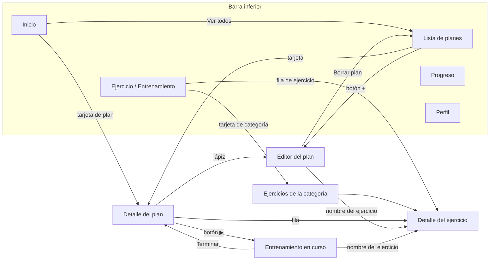
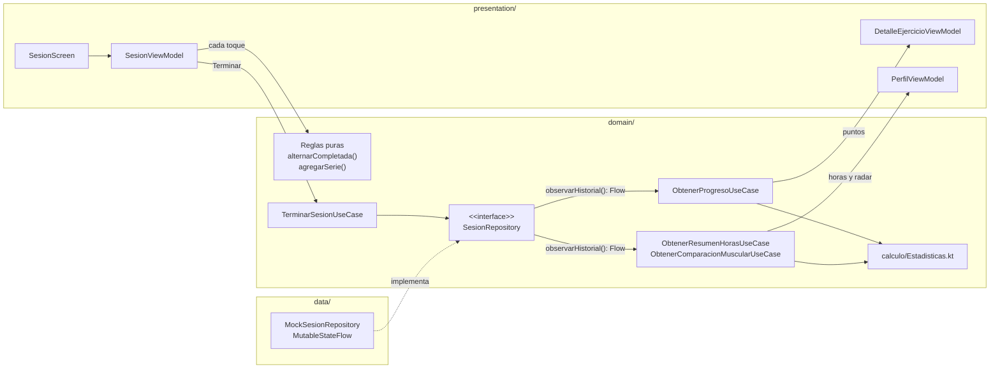
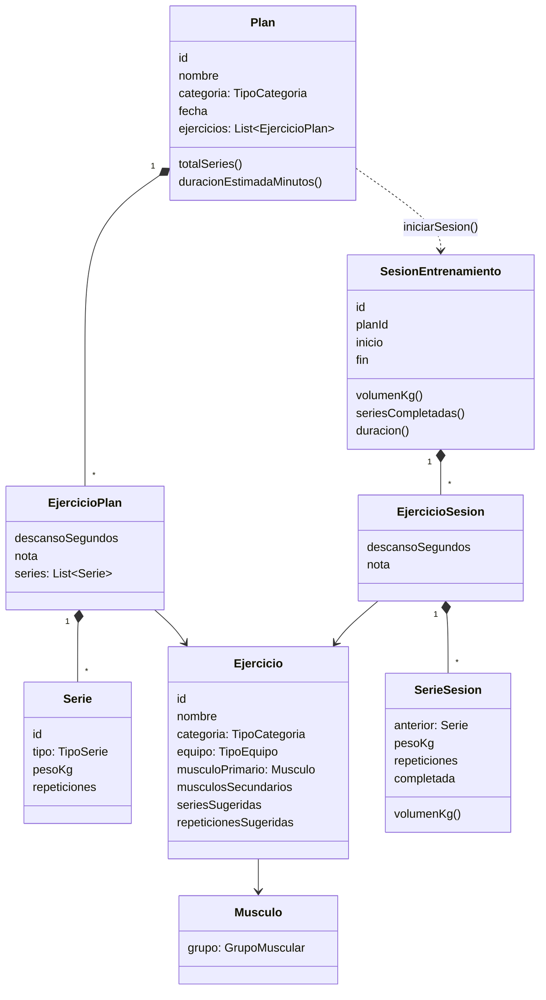

# Velok — Avance 02 (Entrega 2)

Documento para el equipo: qué cambió en la segunda entrega, cómo está organizado el código nuevo
y qué falta. Continúa al [Avance 01](AVANCE-01.md); lo que no cambió (configuración del proyecto,
cómo agregar una pantalla, flujo de Git) se explica allá y aquí solo se resume.

> Todo lo descrito aquí existe en el repositorio a la fecha de este documento. Lo que falta está en
> la sección [Pendientes y siguientes pasos](#12-pendientes-y-siguientes-pasos).

## Contenido

1. [Resumen de la entrega](#1-resumen-de-la-entrega)
2. [Diseños de referencia y pantallas](#2-diseños-de-referencia-y-pantallas)
3. [Qué se implementó](#3-qué-se-implementó)
4. [Arquitectura: qué hay de nuevo](#4-arquitectura-qué-hay-de-nuevo)
5. [Modelo de negocio](#5-modelo-de-negocio)
6. [Archivos nuevos, modificados y eliminados](#6-archivos-nuevos-modificados-y-eliminados)
7. [Cómo se cumple cada criterio de evaluación](#7-cómo-se-cumple-cada-criterio-de-evaluación)
8. [Decisiones técnicas e interpretación de los diseños](#8-decisiones-técnicas-e-interpretación-de-los-diseños)
9. [Pruebas y verificación](#9-pruebas-y-verificación)
10. [Cómo probar la app (recorrido para el equipo)](#10-cómo-probar-la-app-recorrido-para-el-equipo)
11. [Stack y flujo de trabajo](#11-stack-y-flujo-de-trabajo)
12. [Pendientes y siguientes pasos](#12-pendientes-y-siguientes-pasos)

---

## 1. Resumen de la entrega

En la entrega 1 había dos pantallas reales (Inicio y Ejercicio) y tres placeholders. En la
entrega 2 se implementaron los **11 diseños** agregados en `docs/diseno/`, con estos cambios
principales:

| Antes (entrega 1) | Ahora (entrega 2) |
|---|---|
| Tema claro (fondo crema) | **Tema oscuro** (`#171819`), tarjetas blancas; negro puro en sesión y detalles |
| Encabezado negro redondeado con el logo de trazos | Encabezado plano con el logo **VÉLOK** (`Header.png`) y flecha de "atrás" en detalles |
| Calendario, Actividad y Perfil eran placeholders | **Lista de planes**, **Progreso** y **Perfil** con gráficas |
| Pestaña "Ejercicio" = cuadrícula de categorías | "Ejercicio" = **lista con filtros por equipo**; las categorías pasaron a "Entrenamiento" |
| Planes de solo lectura | Planes que se **crean, editan y borran** |
| No existía la sesión de entrenamiento | **Entrenamiento en curso** con cronómetro, volumen, series y descanso |
| 4 casos de uso, 2 pruebas | **16 casos de uso**, **29 pruebas** |

En números: 10 pantallas, 12 casos de uso nuevos (y 1 modificado), 3 repositorios nuevos,
13 íconos nuevos, 27 pruebas nuevas y ninguna librería nueva.

---

## 2. Diseños de referencia y pantallas

Cada diseño de `docs/diseno/` y dónde quedó en el código (rutas relativas a
`shared/src/commonMain/kotlin/com/velok/app/presentation/`):

| Diseño | Pantalla | Ruta de navegación | Archivo |
|---|---|---|---|
| `Header.png` | Encabezado (todas) | — | `components/VelokHeader.kt` |
| `Pantalla inicio.png` | Inicio | `RutaInicio` | `dashboard/DashboardScreen.kt` |
| `Pantalla planes.png` | Lista de planes | `RutaPlanes` | `planes/PlanesScreen.kt` |
| `Informacion del plan.png` | Detalle del plan | `RutaDetallePlan(planId)` | `detalleplan/DetallePlanScreen.kt` |
| `Borrar plan.png` | Editor del plan | `RutaEditarPlan(planId)` | `editarplan/EditarPlanScreen.kt` |
| `Ejercicio en progreso.png` | Entrenamiento en curso | `RutaSesion(planId)` | `sesion/SesionScreen.kt` |
| `Informacion del ejercicio.png` | Detalle del ejercicio | `RutaDetalleEjercicio(ejercicioId)` | `detalleejercicio/DetalleEjercicioScreen.kt` |
| `Pantalla ejercicios v1.png` | Pestaña "Ejercicio" | `RutaEjercicio` | `ejercicio/EjercicioScreen.kt` |
| `Pantalla ejercicios v2.png` | Pestaña "Entrenamiento" | `RutaEjercicio` | `ejercicio/EjercicioScreen.kt` |
| `Pantalla progreso.png` | Progreso (pestaña Actividad) | `RutaActividad` | `progreso/ProgresoScreen.kt` |
| `Pantalla progreso-1.png` | Perfil | `RutaPerfil` | `perfil/PerfilScreen.kt` |
| *(sin diseño)* | Ejercicios de una categoría | `RutaCategoria(categoria)` | `categoria/CategoriaScreen.kt` |

La pantalla de categoría no tiene diseño propio: reutiliza el formato de lista de "Información del
plan" para que tocar una categoría lleve a algún lado.

### Mapa de navegación



---

## 3. Qué se implementó

### Inicio
- Misma información que en la entrega 1 (actividad diaria, anillo, métricas, carrusel de planes),
  ahora sobre fondo oscuro y con las cuatro métricas en tarjetas blancas con borde.
- La tarjeta "Actividad diaria" se extrajo a `components/TarjetaActividadDiaria.kt` porque también
  la usa la pantalla de Progreso.
- Las tarjetas del carrusel ahora muestran nombre, fecha, número de series y duración estimada.
- "Ver todos" lleva a la **Lista de planes**; una tarjeta abre el **detalle del plan**.
- Los planes se **observan** (`Flow`): si editas o borras un plan, el carrusel se actualiza solo.

### Lista de planes (pestaña Calendario)
- Cuadrícula de 2 columnas con `PlanCard`: imagen con etiqueta de categoría, nombre, fecha,
  series y minutos.
- Botón flotante **+**: crea un plan vacío (`CrearPlanUseCase`) y abre el editor.
- Mensaje cuando no hay planes.

### Detalle del plan
- Título con el nombre del plan y un **lápiz** para editarlo.
- Lista de ejercicios (`EjercicioFila`): miniatura con ícono ▶, nombre y "12 × 4 series"
  (repeticiones de la primera serie normal × número de series normales).
- Botón flotante **▶** para empezar el entrenamiento (solo si el plan tiene ejercicios).

### Editor del plan (diseño "Borrar plan")
- Nombre del plan editable.
- Por cada ejercicio: foto redonda, nombre en azul (abre su detalle), menú **⋮** con
  "Eliminar ejercicio", chip **Descanso** (0 s a 3 min) y chip **Nota** (muestra un campo de texto).
- Tabla **SERIE / KG / REPS** con campos editables. Las series de calentamiento se muestran como
  **W** en ámbar; tocar el número de serie la cambia entre normal y calentamiento.
- **Agregar serie** (copia los valores de la última) y **Agregar ejercicio** (hoja inferior con el
  catálogo).
- **Borrar plan** con diálogo de confirmación; al borrar vuelve a la Lista de planes.
- No hay botón "Guardar": **cada cambio se guarda al instante**.

### Entrenamiento en curso (diseño "Ejercicio en progreso")
- Resumen arriba: **Duración** (cronómetro que avanza cada segundo), **Volumen** (kg) y **Series**
  completadas.
- Por ejercicio: tabla **SERIE / ANTERIOR / KG / REPS / ✓**. "ANTERIOR" muestra lo planeado
  (por ejemplo "10kg x 12"); KG y REPS empiezan con esos valores y se pueden cambiar.
- Al tocar **✓** la serie se marca en verde lima, se suman volumen y series, y empieza la
  **cuenta regresiva del descanso** en el chip (en verde). Tocar el chip termina el descanso.
- Agregar serie, nota por ejercicio y eliminar ejercicio desde el menú ⋮.
- **Terminar entrenamiento** guarda la sesión en el historial. Si no se completó ninguna serie,
  pregunta si quieres salir sin guardar.

### Ejercicio / Entrenamiento
- Pestaña **Ejercicio**: chips **Barra, Pesa, Tapete, Máquina** (tocar el seleccionado lo quita y
  se ven todos) y lista de ejercicios del catálogo.
- Pestaña **Entrenamiento**: la cuadrícula escalonada de categorías de la entrega 1. Ahora cada
  tarjeta abre la lista de ejercicios de esa categoría.

### Detalle del ejercicio
- Imagen del ejercicio, nombre, **músculo primario** y **secundarios**.
- Tarjeta **Resumen** con selector de métrica (**Peso, Volumen, Repeticiones**), selector de periodo
  (**3 días, 7 días, Último mes, Últimos 3 meses**), gráfica de línea y botón (i) con una explicación.
- La gráfica muestra un punto por sesión **de ese ejercicio**, calculado del historial.

### Progreso (pestaña Actividad)
- Tarjeta "Actividad diaria" + tarjeta **Resumen** igual a la del detalle, pero sumando **todos**
  los ejercicios de cada sesión.

### Perfil (diseño "Pantalla progreso-1")
- Foto (círculo gris mientras no haya foto) y saludo **"Hola Checo"**.
- **"N horas esta semana"** y gráfica de **barras verde lima** con las horas entrenadas por semana;
  selector **Último mes / Últimos 3 meses**.
- **Gráfica de radar** con las series por grupo muscular (Espalda, Pecho, Core, Hombros, Brazos,
  Piernas): verde lima = periodo actual, gris = periodo anterior de la misma duración.
- El diseño usa **azul** en las gráficas y el selector del perfil; se cambió al **verde lima** de la
  marca para que la pantalla sea consistente con el resto de la app (ver
  [sección 8](#decisiones-técnicas)).
- Abajo, **"Ejecutando en Android 35"**: el ejemplo `expect/actual` de `Platform` sigue visible.

### Encabezado y navegación
- Logo `logo_velok_encabezado.png`, **copia sin cambios** de `docs/diseno/Header.png` (regla de no
  redibujar recursos del diseño), a 134×25.5 dp.
- **Flecha de "atrás"** en pantallas de detalle: Android tiene botón del sistema, pero iOS no.
- La barra inferior sigue marcando la pestaña de origen aunque estés en un detalle, y cada pestaña
  recuerda qué pantallas tenía abiertas.

### Gráficas dibujadas con Canvas
En `components/Graficas.kt`, sin librerías externas:
- `GraficaLinea`: línea verde lima con área degradada y punto final (Resumen).
- `GraficaBarras`: barras con etiquetas en ambos ejes (horas por semana).
- `GraficaRadar`: hexágono con anillos guía y dos polígonos (actual y anterior).

---

## 4. Arquitectura: qué hay de nuevo

Se mantiene **Clean Architecture + MVVM** (explicada en el [Avance 01](AVANCE-01.md#3-arquitectura)).
Lo nuevo en esta entrega:

### 4.1 Reglas de negocio como funciones puras

Las reglas (agregar series, completar series, calcular volumen, estadísticas...) viven en el
**dominio** como funciones que reciben un modelo y devuelven **una copia nueva**, sin modificar
nada. Ejemplo real de `domain/model/SesionEntrenamiento.kt`:

```kotlin
fun SesionEntrenamiento.alternarCompletada(indiceEjercicio: Int, idSerie: Int): SesionEntrenamiento =
    actualizarSerie(indiceEjercicio, idSerie) { serie ->
        when {
            serie.completada -> serie.copy(completada = false)
            (serie.repeticiones ?: 0) <= 0 -> serie   // regla: sin repeticiones no se completa
            else -> serie.copy(completada = true)
        }
    }
```

Ventajas: el ViewModel queda muy simple (solo llama a la regla y actualiza su estado) y las reglas
se pueden **probar sin UI, sin repositorios y sin coroutines**.

### 4.2 Nuevo paquete `domain/calculo/`

`Estadisticas.kt` contiene los cálculos del progreso a partir del historial de sesiones:
`calcularProgreso`, `calcularHorasPorSemana`, `calcularDistribucionMuscular` e `inicioDeSemana`.
Reciben la zona horaria como parámetro para poder probarlos con fechas fijas.

### 4.3 Datos observables (`Flow`)

`PlanRepository` y `SesionRepository` exponen `Flow`. Los mocks guardan los datos en un
`MutableStateFlow`, así que cualquier cambio llega solo a todas las pantallas que lo observan.



Al terminar un entrenamiento, la sesión entra al historial y **las gráficas del detalle del
ejercicio, de Progreso y del Perfil se recalculan solas**.

### 4.4 Pantallas de detalle con parámetros

Las rutas de detalle llevan el id (`RutaDetallePlan(planId)`), y el ViewModel lo recibe por Koin:

```kotlin
// presentation/detalleplan/DetallePlanScreen.kt
viewModel: DetallePlanViewModel = koinViewModel(key = planId) { parametersOf(planId) }

// di/Modulos.kt
viewModel { params -> DetallePlanViewModel(params.get(), get()) }
```

### 4.5 ViewModels que reaccionan a selectores

En Detalle del ejercicio, Progreso y Perfil, cambiar la métrica o el periodo vuelve a pedir los
datos con `flatMapLatest`: si el usuario cambia de opción rápido, solo cuenta la última.

### 4.6 Agrupar eventos (`AccionesXxx`)

El editor y la sesión tienen más de diez eventos. En vez de pasar diez parámetros sueltos a
`XxxContenido`, se agrupan en `AccionesEditarPlan` y `AccionesSesion`, con valores por defecto
vacíos para que los `@Preview` sean cortos.

---

## 5. Modelo de negocio

### Entidades



Enums nuevos: `TipoEquipo` (Barra, Pesa, Tapete, Máquina), `Musculo` (12 músculos),
`GrupoMuscular` (6 grupos), `TipoSerie` (Normal, Calentamiento), `MetricaProgreso` (Peso, Volumen,
Repeticiones) y `RangoTiempo` (3, 7, 30 y 90 días). Modelos de resultado: `PuntoProgreso`,
`HorasSemana`, `ResumenHoras`, `ComparacionMuscular` y `Usuario`.

### Reglas de negocio

| Regla | Dónde está | Probada en |
|---|---|---|
| Un ejercicio nuevo en el plan trae sus series y repeticiones sugeridas, sin peso | `EdicionPlan.kt` · `agregarEjercicio` | `EdicionPlanTest` |
| "Agregar serie" copia los valores de la última y usa un id nuevo | `agregarSerie` (plan y sesión) | `EdicionPlanTest`, `SesionEntrenamientoTest` |
| El descanso no puede ser negativo | `cambiarDescanso` | `EdicionPlanTest` |
| Duración estimada = series × (45 s de trabajo + descanso), redondeada hacia arriba | `Plan.duracionEstimadaMinutos` | `EdicionPlanTest` |
| La categoría del plan es la más repetida entre sus ejercicios (en empate, la del primero) y su imagen es la del primer ejercicio de esa categoría | `conCategoriaInferida`, aplicada en `GuardarPlanUseCase` | `EdicionPlanTest` |
| Al guardar, el nombre del plan se guarda sin espacios sobrantes | `GuardarPlanUseCase` | — |
| Al iniciar una sesión, cada serie parte de lo planeado y "ANTERIOR" muestra el plan | `iniciarSesion` | `SesionEntrenamientoTest` |
| Una serie sin repeticiones no se puede completar | `alternarCompletada` | `SesionEntrenamientoTest` |
| Volumen = peso × repeticiones, **solo de series completadas**; sin peso cuenta 0 kg | `SerieSesion.volumenKg`, `SesionEntrenamiento.volumenKg` | `SesionEntrenamientoTest` |
| Una sesión sin series completadas no se guarda | `TerminarSesionUseCase` | — |
| Las series de calentamiento ("W") no cuentan en la numeración | `numerosDeSerie` (presentación) | `NumeracionSeriesTest` |
| Progreso por sesión: Peso = máximo, Volumen = suma, Repeticiones = suma | `calcularProgreso` | `EstadisticasTest` |
| Las semanas van de lunes a domingo; las semanas sin entrenar aparecen con 0 h; las sesiones sin terminar no cuentan | `calcularHorasPorSemana`, `inicioDeSemana` | `EstadisticasTest` |
| Las series cuentan para el grupo de su **músculo primario**; todos los grupos aparecen aunque sea con 0 | `calcularDistribucionMuscular`, `Musculo.grupo` | `EstadisticasTest` |
| El radar compara el periodo elegido con el periodo anterior de la misma duración | `ObtenerComparacionMuscularUseCase` | — |
| Filtrar el catálogo por equipo y/o categoría (null = todos) | `ObtenerEjerciciosUseCase` | — |

### Casos de uso

| Nuevos (12) | Modificado (1) | Sin cambios (3) |
|---|---|---|
| `ObtenerPlanUseCase`, `CrearPlanUseCase`, `GuardarPlanUseCase`, `EliminarPlanUseCase`, `ObtenerEjerciciosUseCase`, `ObtenerEjercicioUseCase`, `IniciarSesionUseCase`, `TerminarSesionUseCase`, `ObtenerProgresoUseCase`, `ObtenerResumenHorasUseCase`, `ObtenerComparacionMuscularUseCase`, `ObtenerUsuarioUseCase` | `ObtenerPlanesUseCase` (ahora devuelve `Flow`) | `ObtenerActividadDiariaUseCase`, `ObtenerMetricasUseCase`, `ObtenerCategoriasUseCase` |

### Datos simulados

`data/repository/DatosMock.kt` reúne los datos que comparten los mocks:
- **21 ejercicios** en las 8 categorías y los 4 tipos de equipo, con músculos primarios y secundarios.
- **4 planes**: Set del Lunes (Pecho, 6 ejercicios), Set del Martes (Brazos), Set del Miércoles
  (Pierna, con la sentadilla del diseño: 4 series + 2 de calentamiento) y Set del Sábado (Espalda).

`MockSesionRepository` genera un **historial de 42 días** (semilla fija, siempre igual): cada plan
se entrena el día de su nombre con 75 % de probabilidad, entre 30 y 50 minutos, y el peso sube
1.25 kg por semana con variación de ±2.5 kg por sesión. Sin ese historial las gráficas saldrían vacías.

`MockUsuarioRepository` devuelve el usuario "Checo".

---

## 6. Archivos nuevos, modificados y eliminados

Rutas relativas a `shared/src/commonMain/kotlin/com/velok/app/` salvo que se indique otra cosa.

### Dominio

| Archivo | Estado | Qué hace |
|---|---|---|
| `domain/model/Ejercicio.kt` | Nuevo | `Ejercicio`, `TipoEquipo`, `Musculo`, `GrupoMuscular` |
| `domain/model/Plan.kt` | Modificado | `Plan` con nombre, fecha y ejercicios; `EjercicioPlan`, `Serie`, `TipoSerie`; duración estimada |
| `domain/model/EdicionPlan.kt` | Nuevo | Reglas para editar un plan (renombrar, agregar/eliminar ejercicio, series, descanso, nota, categoría inferida) |
| `domain/model/SesionEntrenamiento.kt` | Nuevo | Sesión, `EjercicioSesion`, `SerieSesion` y sus reglas (iniciar, completar, agregar serie...) |
| `domain/model/Progreso.kt` | Nuevo | `MetricaProgreso`, `RangoTiempo` y modelos de resultado de las estadísticas |
| `domain/model/Usuario.kt` | Nuevo | Nombre y foto del usuario |
| `domain/calculo/Estadisticas.kt` | Nuevo | Progreso, horas por semana y distribución muscular |
| `domain/repository/EjercicioRepository.kt` | Modificado | Ahora es el catálogo: categorías, ejercicios y ejercicio por id (los planes se movieron) |
| `domain/repository/PlanRepository.kt` | Nuevo | Observar, guardar y eliminar planes |
| `domain/repository/SesionRepository.kt` | Nuevo | Historial de sesiones |
| `domain/repository/UsuarioRepository.kt` | Nuevo | Usuario actual |
| `domain/usecase/*` | 12 nuevos, 1 modificado | Ver [Casos de uso](#casos-de-uso) |

### Datos e inyección de dependencias

| Archivo | Estado | Qué hace |
|---|---|---|
| `data/repository/DatosMock.kt` | Nuevo | Catálogo de ejercicios y planes de ejemplo |
| `data/repository/MockEjercicioRepository.kt` | Modificado | Lee el catálogo de `DatosMock` |
| `data/repository/MockPlanRepository.kt` | Nuevo | Planes en memoria (`MutableStateFlow`) |
| `data/repository/MockSesionRepository.kt` | Nuevo | Historial en memoria con 42 días generados |
| `data/repository/MockUsuarioRepository.kt` | Nuevo | Usuario fijo |
| `di/Modulos.kt` | Modificado | Registra los repositorios, casos de uso y ViewModels nuevos; `Clock` como `single`; ViewModels con parámetros |

### Presentación

| Archivo | Estado | Qué hace |
|---|---|---|
| `App.kt` | Modificado | Fondo oscuro fijo, flecha de "atrás" y pestaña seleccionada correcta en detalles |
| `theme/Color.kt` | Modificado | Paleta oscura medida en los diseños; tokens nuevos (`fondoProfundo`, `superficieOscura`, `informativo`, `calentamiento`, `chipActivo`...) |
| `theme/Tipografia.kt` | Modificado | Estilos nuevos para saludo, nombres en listas y encabezados de tabla |
| `theme/Formas.kt` | Modificado | Se quitó la forma del encabezado redondeado; se agregó la de la hoja inferior |
| `theme/VelokTheme.kt` | Modificado | Esquema de Material con fondo oscuro y diálogos/menús claros |
| `navigation/Rutas.kt` | Modificado | Rutas de detalle con id; la pestaña Calendario ahora es `RutaPlanes` |
| `navigation/VelokNavHost.kt` | Modificado | Todas las pantallas y la navegación entre ellas |
| `util/RecursosUi.kt` | Modificado | Textos e íconos de equipos, músculos, grupos, métricas y periodos; fechas cortas; cronómetro |
| `util/Formato.kt` | Modificado | `formatearNumero`, `textoAPeso`, `textoARepeticiones` |
| `components/VelokHeader.kt` | Modificado | Encabezado plano con el logo de `Header.png` y flecha de "atrás" |
| `components/PlanCard.kt` | Modificado | Etiqueta de categoría, nombre, fecha, series y minutos |
| `components/Estados.kt` | Modificado | Colores para fondo oscuro; `EstadoVacio` nuevo; se eliminó `PlaceholderScreen` |
| `components/TarjetaActividadDiaria.kt` | Nuevo | Tarjeta compartida entre Inicio y Progreso |
| `components/TarjetaResumen.kt` | Nuevo | Tarjeta "Resumen" con selectores, gráfica y botón (i); `SelectorDesplegable` |
| `components/Graficas.kt` | Nuevo | Gráficas de línea, barras y radar |
| `components/TablaSeries.kt` | Nuevo | Piezas de las tablas de series: encabezado de ejercicio, insignia de serie, campos de kg/reps, botón ✓, nota, agregar serie |
| `components/EjercicioFila.kt` | Nuevo | Fila de ejercicio con miniatura y ▶ |
| `components/Etiquetas.kt` | Nuevo | Etiqueta de categoría, chip de equipo, chip oscuro y botón flotante |
| `components/TituloPantalla.kt` | Nuevo | Título blanco con acciones a la derecha |
| `dashboard/*` | Modificado | Inicio oscuro; observa los planes |
| `ejercicio/*` | Modificado | Pestañas con lista filtrable y categorías |
| `categoria/*` | Nuevo | Ejercicios de una categoría |
| `planes/*` | Nuevo | Lista de planes |
| `detalleplan/*` | Nuevo | Detalle del plan |
| `editarplan/*` | Nuevo | Editor del plan |
| `sesion/*` | Nuevo | Entrenamiento en curso |
| `detalleejercicio/*` | Nuevo | Detalle del ejercicio con progreso |
| `progreso/*` | Nuevo | Pestaña Actividad |
| `perfil/*` | Nuevo | Perfil con gráficas y el texto de `Platform` |

Cada paquete de pantalla tiene `XxxScreen.kt`, `XxxViewModel.kt` y `XxxUiState.kt`.

### Recursos, pruebas y documentación

| Archivo | Estado | Qué hace |
|---|---|---|
| `composeResources/drawable/logo_velok_encabezado.png` | Nuevo | Copia idéntica de `docs/diseno/Header.png` |
| `composeResources/drawable/logo_velok.xml` | **Eliminado** | El logo de trazos ya no aparece en los diseños (su SVG sigue en `docs/diseno/`) |
| `composeResources/drawable/ic_*.xml` | 13 nuevos | atrás, check, cronómetro, editar, flecha abajo, info, más, más opciones, nota, play, y los equipos barra, tapete y máquina |
| `composeResources/values/strings.xml` | Modificado | Textos de todas las pantallas nuevas, músculos, grupos, periodos, meses cortos y duraciones |
| `shared/src/commonTest/.../domain/*` | Nuevos | `Fixtures`, `EdicionPlanTest`, `SesionEntrenamientoTest`, `EstadisticasTest` |
| `shared/src/commonTest/.../presentation/components/NumeracionSeriesTest.kt` | Nuevo | Numeración de series |
| `shared/src/commonTest/.../presentation/util/FormatoTest.kt` | Modificado | Pruebas de los formatos nuevos |
| `docs/diseno/*.png` | Nuevos | Los 11 diseños de esta entrega |
| `CLAUDE.md` | Modificado | Tema oscuro, logo nuevo y reglas nuevas de arquitectura |

---

## 7. Cómo se cumple cada criterio de evaluación

### Vistas
- Los 11 diseños están implementados y se compararon uno por uno en el emulador.
- Tres gráficas nuevas dibujadas con `Canvas` (línea, barras y radar), además del anillo y las
  mini gráficas de la entrega 1.
- Componentes reutilizables con `@Preview`: 7 archivos de componentes nuevos y previews de cada
  pantalla completa.
- Accesibilidad: descripciones en botones de solo ícono (atrás, editar, ✓, ⋮, +, ▶), en la
  gráfica de radar (lee las series por grupo) y en las series ("Marcar serie 1 como completada").

### Capas
- Las pantallas nuevas siguen el mismo flujo: Pantalla → ViewModel → Caso de uso → Repositorio.
- Las reglas de negocio están en el dominio, no en los ViewModels ni en las pantallas.
- El dominio sigue siendo Kotlin puro: no importa Compose ni recursos ni tiene textos visibles.
- Los repositorios nuevos son interfaces; los mocks se cambian en `di/Modulos.kt` sin tocar nada más.

### Modelo de negocio
- Entidades nuevas que modelan el gimnasio real: planes con series, sesiones, ejercicios con
  equipo y músculos, y grupos musculares.
- Más de quince reglas de negocio explícitas ([tabla](#reglas-de-negocio)), casi todas con pruebas.
- Estadísticas derivadas del historial (progreso, horas por semana, distribución muscular).

### Multiplataforma
- Todo lo nuevo está en `commonMain`: no hizo falta código específico de plataforma.
- **Nuevo en esta entrega:** el código Kotlin de iOS se **compiló desde Windows**
  (`:shared:compileKotlinIosArm64` y `:shared:compileKotlinIosSimulatorArm64`). Falta enlazar el
  framework y correrlo en Xcode, que requiere una Mac.
- La flecha de "atrás" del encabezado existe porque iOS no tiene botón de atrás del sistema.
- El ejemplo `expect/actual` de `Platform` sigue visible en Perfil.

### Funcionalidad
- Crear, editar y borrar planes; los cambios se ven al instante en todas las pantallas.
- Registrar un entrenamiento completo: marcar series, ajustar peso y repeticiones, descansos con
  cuenta regresiva, notas, agregar series y guardar en el historial.
- Filtrar ejercicios por equipo y navegar por categorías.
- Consultar el progreso por ejercicio o general con distintas métricas y periodos.

---

## 8. Decisiones técnicas e interpretación de los diseños

### Decisiones técnicas

| Decisión | Por qué |
|---|---|
| **Tema oscuro con diálogos y menús claros** | Los diseños son oscuros pero sus tarjetas son blancas. Se usa un esquema de Material claro con fondo oscuro, para que diálogos, menús y hojas inferiores se vean como tarjetas. |
| **Logo como PNG copiado tal cual** | La regla del proyecto prohíbe redibujar recursos del diseño, y `Header.png` es el único archivo con el logo "VÉLOK". |
| **Duración del plan calculada, no guardada** | Si fuera un número fijo, quedaría mal al editar el plan. Calculada (45 s por serie + descanso) cambia sola. |
| **Guardado automático en el editor** | El diseño no tiene botón "Guardar". Cada cambio aplica una regla del dominio y se guarda. |
| **Campos de kg/reps con texto propio** | Permite escribir "2." antes de "2.5" sin que el campo se corrija solo. Acepta coma o punto. |
| **Ids en las series** | Las series se editan por id, no por posición; así agregar o cambiar series no confunde los campos. |
| **Historial simulado con semilla fija** | Las gráficas necesitan datos; con semilla fija se ven igual en todas las computadoras. |
| **Sin librerías nuevas** | Las gráficas se dibujan con `Canvas` y las pruebas no necesitan `kotlinx-coroutines-test` porque las reglas son funciones puras. |
| **Azul `informativo` solo en sesión y editor** | Los diseños de sesión y editor usan azul para los nombres de ejercicio y la duración, y se respetó. Es un token propio: si se prefiere el verde de la marca, se cambia en un solo lugar (`theme/Color.kt`). |
| **Perfil en verde lima en lugar de azul** | El diseño "Pantalla progreso-1" usa azul en las barras, el radar y el selector de periodo. Se cambiaron al verde lima de la marca (`acento`) para que las gráficas del perfil sean consistentes con las de Inicio, Progreso y Detalle del ejercicio. |

### Interpretación de los diseños

| Tema | Qué se decidió |
|---|---|
| **"Pantalla progreso-1"** | Se usó como **Perfil** por la foto y el saludo, aunque en el diseño aparece marcada la pestaña Actividad. |
| **"Borrar plan"** | Se tomó como el **editor del plan**, con el botón "Borrar plan" al final. |
| **"10 Reps" en las tarjetas de plan** | No coincide con el contenido del plan, así que se muestra el **total de series**; "120 Mins" se reemplazó por la **duración estimada**. |
| **Textos en inglés de los diseños** | "Heart Rate", "Chest", "Muscle", "Set" se tradujeron (regla: toda la UI en español). |
| **Agregado sin diseño** | Flecha de atrás, lápiz para editar, botón "Terminar entrenamiento", "Agregar ejercicio", cambiar la serie a calentamiento tocando su número, terminar el descanso tocando el chip y pantalla de categoría. |
| **Del diseño que no se puso** | Siluetas del cuerpo en "Ejercicio en progreso" (no venían como archivo y no se pueden redibujar), botón de pausa de la animación (las imágenes aún son estáticas) y la flecha de "REPS ▼". |
| **Periodo inicial de "Resumen"** | El diseño muestra "3 Dias", pero con un entrenamiento cada 2–3 días saldría casi vacía; se inicia en "Último mes" y "3 días" sigue como opción. |

---

## 9. Pruebas y verificación

### Pruebas unitarias (29, todas pasan)

| Clase | Pruebas | Qué cubre |
|---|---|---|
| `EdicionPlanTest` | 10 | Agregar ejercicio y series, actualizar series, tipo de serie, índices inválidos, eliminar, descanso, duración estimada, categoría inferida |
| `SesionEntrenamientoTest` | 7 | Iniciar sesión, volumen, completar y desmarcar, sin repeticiones, sin peso, agregar serie, duración |
| `EstadisticasTest` | 6 | Inicio de semana, progreso de peso, volumen y repeticiones, filtros de rango y ejercicio, horas por semana, distribución muscular |
| `FormatoTest` | 5 | Miles, decimales, números cortos, conversión de texto a peso y repeticiones |
| `NumeracionSeriesTest` | 1 | El calentamiento no cuenta en la numeración |

```bash
./gradlew :shared:testAndroidHostTest
```

### Verificación realizada

- `./gradlew :androidApp:assembleDebug` compila sin advertencias en el código del proyecto.
- `:shared:compileKotlinIosArm64` y `:shared:compileKotlinIosSimulatorArm64` compilan desde Windows.
- Recorrido completo en el emulador `Pixel_8_2` comparando cada pantalla con su diseño, incluidos
  los flujos de completar series, filtrar ejercicios, crear un plan y borrar un plan. Sin cierres
  inesperados ni bloqueos de la app (ANR).
- **Error encontrado y corregido durante la revisión:** al volver a una pestaña que tenía abierta una
  pantalla de detalle, la barra inferior marcaba la pestaña anterior. Se corrigió en `App.kt`.
- **Ajuste de datos:** la gráfica de un ejercicio salía como una línea recta porque el historial
  simulado subía el peso exactamente igual cada semana; se agregó variación por sesión.

---

## 10. Cómo probar la app (recorrido para el equipo)

1. **Inicio:** revisa la tarjeta de actividad y desliza el carrusel. Toca "Ver todos".
2. **Lista de planes:** abre "Set del Miércoles".
3. **Detalle del plan:** toca ▶.
4. **Entrenamiento:** toca ✓ en la serie 1 de la sentadilla. Deben cambiar Volumen (120 kg) y
   Series (1), y el chip de descanso cuenta hacia atrás en verde. Cambia un peso, agrega una serie
   y toca **Terminar entrenamiento**.
5. Vuelve a la pestaña **Ejercicio**, abre "Sentadilla (Barra)" y mira el **Resumen**: el
   entrenamiento que acabas de guardar aparece como el último punto. Prueba los selectores.
6. **Ejercicio:** toca el chip "Barra" para filtrar; tócalo otra vez para quitar el filtro.
   Cambia a "Entrenamiento" y abre una categoría.
7. **Planes → +:** escribe un nombre, agrega un ejercicio, cambia el descanso y marca una serie
   como calentamiento tocando su número. Vuelve: el plan aparece en la lista.
8. Desde el editor, toca **Borrar plan** y confirma: vuelves a la lista sin ese plan.
9. **Actividad** y **Perfil:** revisa el Resumen general, las horas por semana, el radar y el
   texto "Ejecutando en Android ...".

> Los datos viven en memoria: al cerrar la app se vuelve a los datos de ejemplo.

---

## 11. Stack y flujo de trabajo

- **Sin cambios de librerías ni versiones** respecto al Avance 01 (ver la
  [tabla de librerías](AVANCE-01.md#6-stack-y-librerías)). Material 3 sigue en `1.12.0-alpha03`.
- **Cómo ejecutar:** igual que en el [Avance 01](AVANCE-01.md#8-cómo-ejecutar-el-proyecto).
- **Cómo agregar una pantalla:** misma guía del [Avance 01](AVANCE-01.md#9-cómo-agregar-una-nueva-pantalla).
  Si la pantalla recibe un id, sigue además el patrón de la [sección 4.4](#44-pantallas-de-detalle-con-parámetros).
- **Git:** mismo flujo del [Avance 01](AVANCE-01.md#10-flujo-de-trabajo-con-git): rama
  `feature/*` desde `main` actualizado, commits manuales y Pull Request con *Squash and merge*.
  Esta entrega se trabaja en la rama `feature/nuevas-pantallas`.

---

## 12. Pendientes y siguientes pasos

### Resueltos del Avance 01
- [x] **Pantalla de sesión activa:** implementada (Entrenamiento en curso).
- [x] **Tarjetas sin acción:** las categorías abren su lista de ejercicios y los planes su detalle;
      "Ver todos" lleva a la Lista de planes.
- [x] **Placeholders:** Calendario, Actividad, Perfil y la pestaña "Entrenamiento" ya tienen pantalla.
- [x] **Modo oscuro:** la app ahora es oscura, como piden los diseños.
- [x] **Pruebas:** de 2 a 29, cubriendo las reglas del dominio.
- [ ] **iOS (parcial):** el código Kotlin ya compila para iOS; falta enlazar y probar en una Mac con Xcode.

### Siguen pendientes
- [ ] **Imágenes reales** de categorías y ejercicios (hoy son placeholders). Las animaciones de
      ExerciseDB permitirían agregar el botón de pausa del diseño.
- [ ] **Health Connect / HealthKit** para la actividad diaria.
- [ ] **API de ExerciseDB** para el catálogo (clave en `local.properties`, nunca en el repositorio).
- [ ] **Probar en iOS con una Mac.**
- [ ] **Notificaciones:** `App.kt` sigue pasando `tieneNotificaciones = true` y la campana no hace nada.
- [ ] **Ícono de la app**, **`iosX64`** para simulador en Mac Intel, **limpieza del catálogo de
      versiones** y **actualizar Material 3 / Navigation** cuando salgan estables.

### Nuevos
- [ ] **Persistencia:** planes e historial viven en memoria y se pierden al cerrar la app. Siguiente
      paso natural: una base de datos local multiplataforma (por ejemplo Room o SQLDelight) que
      implemente `PlanRepository` y `SesionRepository`.
- [ ] **Sesión en curso:** si sales del entrenamiento sin tocar "Terminar", se pierde. Podría
      guardarse como sesión activa en `SesionRepository` o pedir confirmación al salir.
- [ ] **Borrar una serie** en el editor y en la sesión (no hay control en el diseño; por ejemplo,
      deslizar la fila).
- [ ] **Siluetas del cuerpo** en el resumen de la sesión: pedir el recurso al equipo de diseño.
- [ ] **Logo en mejor resolución:** `Header.png` mide 268×51 px y en pantallas grandes puede verse
      algo borroso. Lo ideal es un SVG del logo con el texto "VÉLOK".
- [ ] **Confirmar interpretaciones** de la [sección 8](#interpretación-de-los-diseños) con el
      equipo (sobre todo Perfil vs. Actividad y el texto "Reps" de las tarjetas).
- [ ] **Pruebas de casos de uso y ViewModels** con repositorios falsos (requiere
      `kotlinx-coroutines-test`).
- [ ] **README:** actualizar la descripción general cuando se cierre la entrega.
